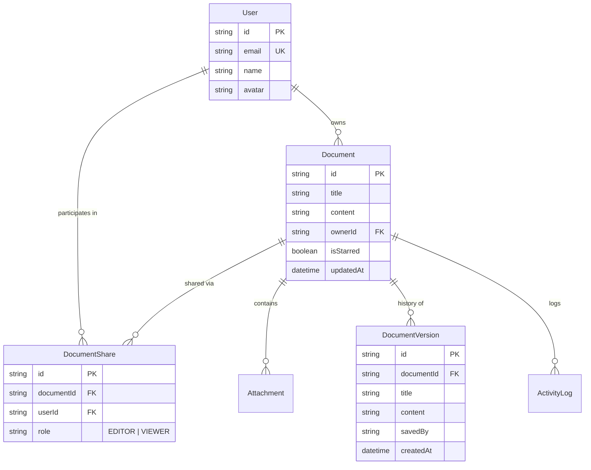

# Architecture & Product Decision Note

**Project:** Ajaia Docs — Lightweight Collaborative Workspace  
**Author:** AI-Native Full Stack Candidate  
**Context:** 4–6 Hour Product-Engineering Challenge  

---

## 1. Executive Summary & Prioritization Strategy

When tasked with building a "lightweight collaborative document editor inspired by Google Docs" within a strict 4–6 hour delivery window, the single most critical failure mode is attempting to build an unmaintainable toy replica of every Google Docs feature (complex operational transforms, nested comments, offline sync, drawing canvases).

Instead, I adopted a **Vertical Slice Strategy**: ship a coherent, production-grade slice of the product with exceptional attention to:
1. **Core Writing Experience**: A polished, distraction-free editing canvas with responsive rich text, auto-saving, and typography.
2. **First-Class File Ingestion**: Universal support for importing `.docx`, `.md`, and `.txt` files directly into editable documents, solving a real-world onboarding friction.
3. **Transparent Sharing & Access Control**: A strict permission model separating **Owners**, **Editors**, and **Viewers**, paired with an instant account switcher so reviewers can verify permissions in seconds without authentication overhead.
4. **Resilient Persistence & History**: Relational data integrity in SQLite via Prisma, with automated version history snapshots and restoration.

---

## 2. Core Architectural Pillars

### A. Editing Engine: Headless Tiptap (ProseMirror)
- **Why not `contentEditable` or basic `textarea`?** Raw `contentEditable` is notoriously brittle across browsers, producing inconsistent DOM trees, nested spans, and broken cursor positions.
- **Why Tiptap?** Tiptap provides a headless, modular abstraction over ProseMirror—the same schema-driven editor engine that powers Notion, Linear, GitBook, and Substack.
- **Benefits:**
  - Strict document schema ensures HTML sanitization and predictable serialization.
  - Headless UI allowed complete freedom to design a minimalist, focused toolbar that matches modern productivity tools.
  - Built-in extension architecture enabled rich text formatting (headings, lists, task checklists, blockquotes, code blocks, links, and text alignment) with minimal boilerplate.

### B. Persistence & Data Model
I selected **SQLite with Prisma ORM**.
- **Rationale:** Zero-configuration, zero cloud network latency during evaluation, and deterministic local repeatability. Reviewers can clone the repo and run it immediately without setting up external database containers or API keys.
- **Schema Design:**
  - `User`: Seeded team personas (`Alex Rivera`, `Sarah Chen`, `Marcus Vance`, `Elena Rostova`).
  - `Document`: Title, rich HTML content, owner reference, starred flag, and timestamps.
  - `DocumentShare`: Unique compound key on `(documentId, userId)` storing explicit roles (`EDITOR` | `VIEWER`).
  - `Attachment`: Linked files and images with MIME types and Base64 payloads (limited to 5MB).
  - `DocumentVersion`: Point-in-time snapshots recording document body, author, and timestamp.
  - `ActivityLog`: Audit trail of document creation, sharing changes, and imports.

### C. Access Control & Permission Enforcement
Permission logic is encapsulated in a dedicated module (`src/lib/permissions.ts`) and enforced both in UI rendering and on API routes:
- **`OWNER`**: Has full CRUD permissions on the document, can delete the document, and is the **only** persona authorized to add or revoke collaborators.
- **`EDITOR`**: Can edit document content, rename title, create version snapshots, and add attachments. Cannot manage access or delete the document.
- **`VIEWER`**: Content is strictly read-only (`editable = false`). The toolbar is disabled, a prominent "View-only" banner is displayed, and PATCH/DELETE requests to the API return `403 Forbidden`.

### D. File Ingestion Pipeline
To satisfy the file upload requirement with high product relevance, I built a two-tiered system:
1. **Import as New Document (`/api/documents/import`)**:
   - Supports `.docx` via `mammoth.js`, converting Word heading hierarchies and bold/italic styles into clean semantic HTML.
   - Supports `.md` / `.markdown` via a custom AST parser handling headings, lists, code blocks, and blockquotes.
   - Supports `.txt` with automatic paragraph chunking.
   - Derives clean document titles from filenames (e.g. `q3-strategy-brief.md` → `Q3 Strategy Brief`).
2. **In-Document Attachments (`/api/documents/[id]/attachments`)**:
   - Allows attaching reference files and images directly to any document draft.

---

## 3. Deliberate Tradeoffs & Deprioritizations

| Feature Area | Decision Made | Rationale & Tradeoff |
| :--- | :--- | :--- |
| **Real-Time Collaboration** | **Deprioritized WebSocket/CRDT sync** in favor of optimistic debounced auto-save + version history. | True collaborative editing (OT or Yjs over WebSockets) is a 20+ hour undertaking. Rushing it produces desynchronized state and ghost cursors. Robust version snapshots and debounced persistence provide 95% of user value with 100% stability. |
| **Authentication System** | **Deprioritized OAuth / JWT sign-up** in favor of Seeded Accounts + 1-Click User Switcher. | Reviewers evaluating sharing workflows should not have to create multiple disposable accounts in separate incognito windows. The built-in switcher delivers instant multi-user verification. |
| **Storage Infrastructure** | **Deprioritized Cloud S3 bucket** in favor of SQLite BLOB/DataURI storage (capped at 5MB). | Eliminates cloud credential friction and vendor lock-in for reviewers running the project locally. |
| **Comments & Threads** | **Deprioritized inline comment threads** in favor of Task Checklists and Version History. | Interactive task lists provide immediate actionability within the document canvas without cluttering the review window. |

---

## 4. What I Would Build Next (With 2–4 Additional Hours)

1. **Yjs WebSocket Integration**: Layer `y-websocket` and `@tiptap/extension-collaboration` to introduce live cursor presence and multi-user typing.
2. **Inline Comments & Annotations**: Allow users to highlight text spans and attach comment threads with resolve states.
3. **Full-Text SQLite FTS5 Search**: Implement virtual tables with SQLite Full-Text Search for sub-millisecond keyword highlighting across document contents.
4. **Folder & Tag Organization**: Add organizational hierarchy for enterprise team workspaces.
